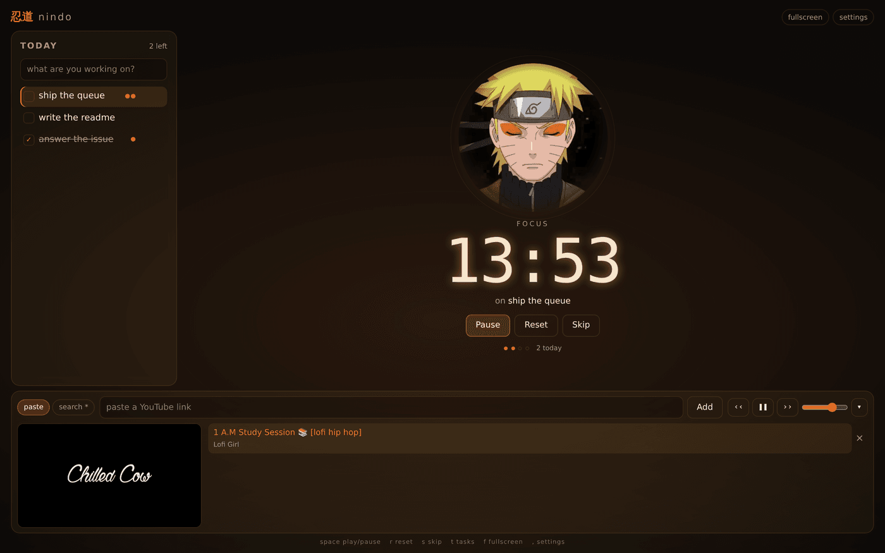
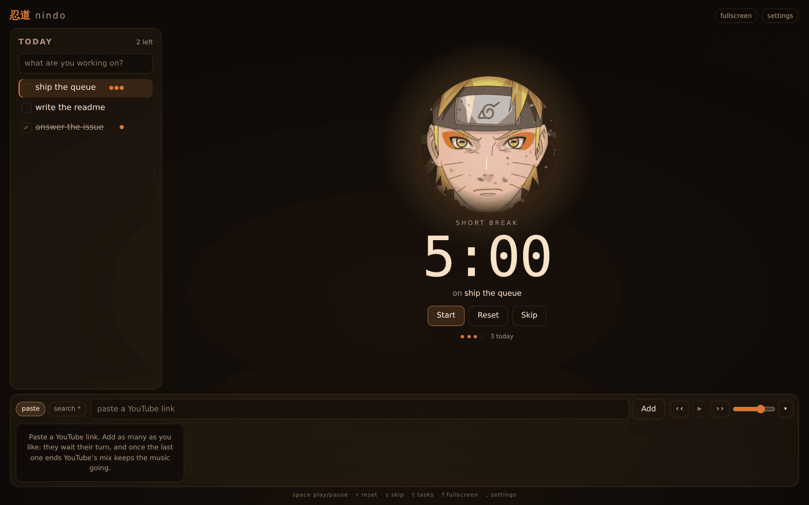
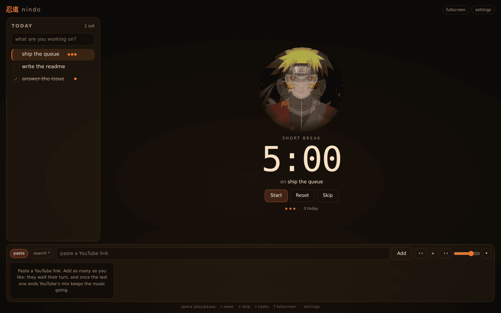
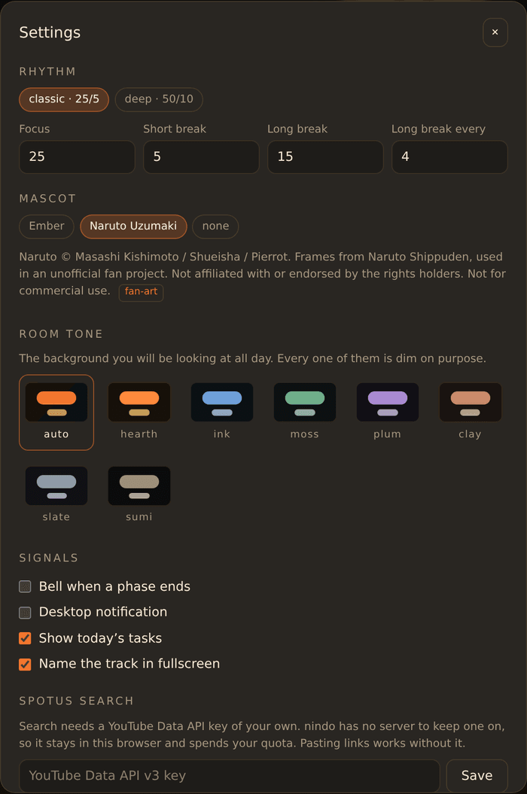
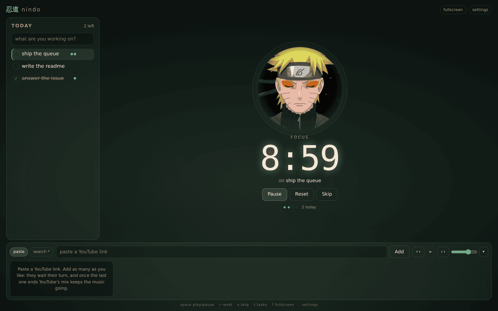
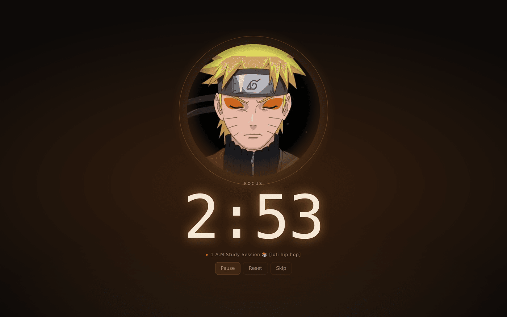
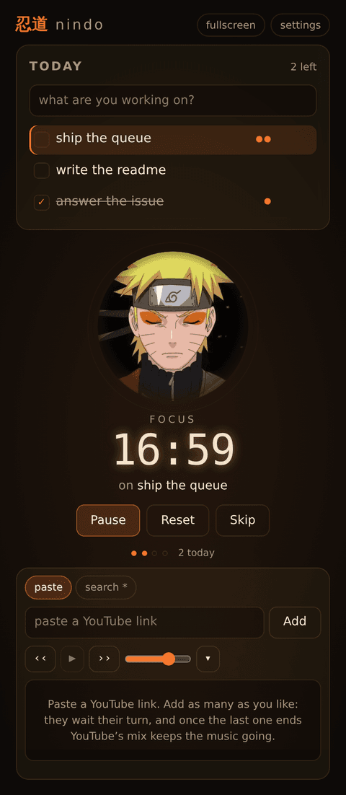

<div align="center">

# 忍道 &nbsp;nindo

### A pomodoro that sits beside your editor

Today's tasks, a mascot that powers up when you finish, and a quiet player.
One warm screen, nothing competing for your attention.

**[→ Open nindo](https://nindo-mu.vercel.app/)** &nbsp;·&nbsp; installs as an app &nbsp;·&nbsp; works offline

[](https://nindo-mu.vercel.app/)
[](#install-it-as-an-app)
[](#what-leaves-your-browser)
[](LICENSE)



</div>

---

## The loop

You write what you are doing today. You point the timer at one of those lines
and start. The mascot meditates while you work and the room slowly warms up:
that glow is the session itself, brighter the closer you get.

When the clock hits zero there is a flash, the screen shakes, and your mascot
stands up transformed.

<div align="center">

| While you focus | The moment it ends |
|---|---|
|  |  |

</div>

Then it hands you the break and the task collects its dot. That is the whole
product; everything else exists to not break that loop.

---

## What you get

### Today's list, and nothing older



A list that lives for exactly one day. Point the timer at a task and finishing a
session credits it with a dot. Tomorrow it starts empty, on purpose: a pomodoro
app that keeps score becomes another thing you owe.

The timer tracks a **deadline**, not a countdown, so closing the laptop,
switching tabs for an hour or restarting the browser all leave it correct. A
session that ended while you were away reports itself once and queues the break,
instead of silently racing through the cycles you missed.

<br clear="right">

### A mascot that is yours to change



Naruto ships as pack #1, playing the real sage-mode awakening frame by frame.
`ember` is the original CC0 one. **Adding your own is a folder and two pictures:**
the flash, the shake, the sparks and the crossfade are already written, so you
never have to animate anything. [Full walkthrough](docs/CHARACTERS.md).

Or switch the mascot off entirely and let the clock take the middle.

### Seven room tones

Pick the background you will be looking at all day, or leave it on `auto` and
let the mascot choose. Every one of them is dim on purpose, and the choice
repaints the whole screen: panels, buttons, the glow on the clock, the aura.

<br clear="right">

<div align="center">



*the same app, in `moss`*

</div>

### Spotus

Paste as many YouTube links as you like. They wait their turn instead of
interrupting, each one leaves the queue once it has played, and when the last
ends **YouTube's own mix keeps the music going**, so a session never falls
silent. Titles arrive with no API key at all. Search is there too, if you bring
your own key. [How it works](docs/SPOTUS.md).

### Fullscreen

<div align="center">



</div>

`F` leaves the mascot, the clock and the name of whatever is playing. Nothing
else. Move the mouse for the controls; leave fullscreen however you like and the
interface comes back.

### On a phone

<div align="center">



</div>

The clock leads and the panels follow it. Add it to your home screen and it runs
like any other app.

---

## Install it as an app

Open **[nindo-mu.vercel.app](https://nindo-mu.vercel.app/)** and install it from
the address bar: the `⊕` icon in Chrome and Edge, *Share → Add to Home Screen*
on iOS, *Share → Add to Dock* in Safari on a Mac.

It then runs in its own window, shows the countdown in your taskbar, and keeps
working with the network unplugged.

Want your own copy instead?

[](https://vercel.com/new/clone?repository-url=https%3A%2F%2Fgithub.com%2FBraianTroncoso%2Fnindo&project-name=nindo&repository-name=nindo)

Nothing to configure: no environment variables, no database, no server to pay
for. Or run it locally:

```bash
git clone https://github.com/BraianTroncoso/nindo
cd nindo
npm install
npm run dev          # http://localhost:3000
```

```
 space  play / pause      r  reset           s  skip
     t  tasks                 f  fullscreen      ,  settings
```

---

## What leaves your browser

Almost nothing, and never quietly:

- **No backend, no account, no database, no analytics, no cookies.** Your tasks,
  settings, playlist and API key live in `localStorage` and nowhere else.
- **No fonts, scripts or icons from a CDN.** The bell is synthesised with
  WebAudio rather than shipping an mp3.
- **YouTube is contacted only when you use Spotus.** Once to read a title
  through the keyless oEmbed endpoint, then by the official embedded player.
  Never during a session without music.

Clearing site data resets nindo to factory. That is the entire data policy.

---

## Contributing

A new mascot pack is the kind of pull request this repo exists for. It needs two
images and no code: **[docs/CHARACTERS.md](docs/CHARACTERS.md)**.

| | |
|---|---|
| [Architecture](docs/ARCHITECTURE.md) | how the pieces fit, and why the timer is built on deadlines |
| [Characters](docs/CHARACTERS.md) | build a mascot pack |
| [Spotus](docs/SPOTUS.md) | the queue, the search key, and three approaches that were measured and rejected |
| [Contributing](docs/CONTRIBUTING.md) | setup, house style, what is in scope |
| [Legal](docs/LEGAL.md) | the fan-art policy, stated plainly |
| [Roadmap](docs/ROADMAP.md) | what is next, and what is deliberately missing |

```bash
npm run lint && npm test && npm run build && npm run smoke
```

60 unit tests cover the pure logic. 32 end-to-end tests run against the real
build, including a suite whose only job is to be hostile to it.

---

## Licence

Code: **[MIT](LICENSE)**.

Art is licensed **per pack**; check each `character.json`. The `ember` pack is
CC0 and yours to do anything with.

The `naruto` pack is **frames from the anime**. Naruto is © Masashi Kishimoto /
Shueisha / Pierrot, this project is not affiliated with or endorsed by them, and
that pack is not for commercial use. If you fork this for anything public,
delete it and ship `ember`. See **[docs/LEGAL.md](docs/LEGAL.md)**.

<div align="center">
<br>

**"I never go back on my word. That's my ninja way."**

<sub>忍道 · nindō · the ninja way</sub>

</div>
